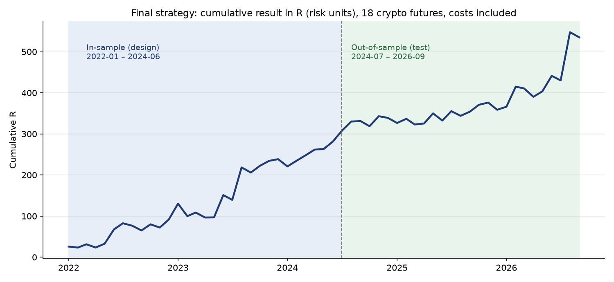

# Crypto Prop Research

Quantitative research project: finding a statistically robust trading edge on crypto futures, stress-testing it against overfitting, simulating prop-firm rules, and running the final strategy as a Telegram signal bot.

> **Note.** This repository describes the research process and results. The source code and exact strategy parameters are kept private because the strategy is in live use. Code walkthrough available on request.

## Goal

Find a strategy and risk policy that can pass a two-phase prop-firm challenge **quickly and with as few failed attempts as possible**: profit targets of +8% and +5%, a 4% daily loss limit and a 10% maximum drawdown. After that, the goal is steady payouts from the funded account.

## Data

- Binance USDT-M perpetual futures: 5-minute bars with taker-buy volume, plus funding rates.
- January 2022 – September 2026, **18 liquid coins**.
- Coins were chosen from those that already existed and were large in 2022, to avoid survivorship bias.

## Methodology

1. **Strict data split.**
   - In-sample (IS), 01.2022–06.2024: used only for design.
   - Out-of-sample (OOS), 07.2024–09.2026: used only for testing.
   - All thresholds and parameters were fixed on IS data.
2. **Conservative execution.**
   - Entry at the next bar's open.
   - 0.13–0.15% round-trip costs (fees plus slippage), and funding is included.
   - If the stop and the target are both touched inside one bar, the trade is counted as stopped out.
   - Gaps are filled at the open price.
3. **Overfitting checks.**
   - Stability year by year.
   - Doubled trading costs.
   - Permutation tests against random entries.
   - Parameter plateaus instead of a single best point.
   - The number of hypotheses tested is taken into account.
4. **Prop-firm simulation.**
   - Equity is recalculated every 5 minutes at the worst price of the bar.
   - Real challenge rules: the daily limit is set from the balance at 00:00 UTC, drawdown is static, there are phase targets, and payouts come every 30 days with an 80% split.
   - A "career" is started from every possible date, and the account is scaled up from $5k to $200k.

## Research log: what didn't work is also a result

| Stage | Hypotheses tested | Outcome |
|---|---|---|
| Intraday, 5m–1h | 244 configurations: breakouts, opening-range breakouts, mean reversion, order-flow imbalance, volume spikes | None significant after costs |
| Swing, 4h–1d | 168 configurations: breakouts with trailing stops, moving-average crosses, funding-rate fade | Trend breakout works (97% of configurations profitable OOS). Funding fade was overfitting: t = +2.0 IS, t = −2.5 OOS |
| Extension | 320 configurations × 18 coins, feature filters, LightGBM walk-forward | A volume-based filter improved Sharpe from 0.95 to 1.32. The ML model was unstable and rejected |
| Risk management | 300+ position-sizing policies by phase, kill switches, limits | Higher risk with a kill switch during the challenge, low risk on the funded account |
| Coin selection | Dropping "losing" coins | Honest selection made OOS worse (Sharpe 1.32 → 1.15), so all 18 coins were kept |

## Final strategy (high level)

- An ensemble of trend-breakout signals on 4h and 8h bars.
- A volume confirmation filter.
- Volatility-based (ATR) stops and trailing exits.
- No fixed take-profit.

| Metric | In-sample | Out-of-sample |
|---|---|---|
| Portfolio Sharpe (daily) | 1.38 | 1.32 |
| Average trade | +0.27R | +0.27R |
| Trades | 1,085 | 916 |
| Days to funded account (median) | 47 | 53 |

The strategy kept almost the same quality on data it had never seen, which was the main goal of the research.

## Product

- **Telegram signal bot.** It scans the market on every 4h/8h bar close, sends entry and exit signals with charts, and tracks challenge rules (daily loss guard, phase).
- **Bot validation.** A validation script checks that the bot produces exactly the same trades as the backtest.
- **Results dashboard** (HTML): every simulated account, trade and payout.
- **Forward testing** on a simulated $5,000 challenge account since October 2026.

## Limitations

- The backtest uses Binance prices, and execution at a prop firm's broker may differ.
- Simulation start dates overlap in time, so the number of truly independent OOS histories is small.
- Within the group of best risk policies, the final choice partly used OOS data, so this estimate is slightly optimistic.
- Crypto assets are highly correlated, so 18 coins give fewer independent bets than the number suggests.
- This is research, not investment advice.

## Tech stack

Python (pandas, NumPy, PyArrow, LightGBM, scikit-learn, matplotlib), Binance public data, Telegram Bot API, HTML/JS dashboard.

## Author

Iskhak Abdikarimov — independent project, 2026.
